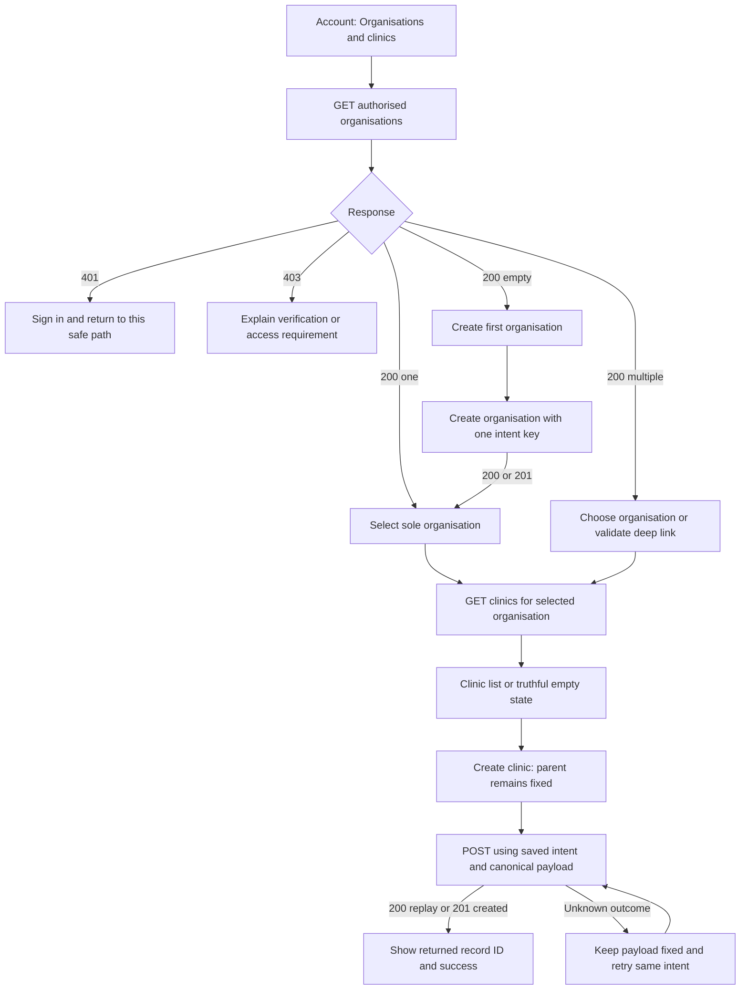

# GO3-273 — Organisation and clinic administration design

Design v1, reviewed and approved by Eze Chiana on 19 November 2026. Design execution: Codex in UI/UX Designer role. Sources: live GO3-273/188/274/35, app/templates/base.html, routes_clinics.py and clinic_registry.py. GO3-273 is Done for its design scope. Engineering readiness is recorded separately on GO3-188; production implementation and independent specialist release review remain on GO3-274/230/251. This artifact is a synthetic prototype; it makes no network requests or production changes.

Approval evidence: explicit user confirmation, “GO3-273’s draft design is reviewed and approved”. The reviewed prototype SHA-256 is `ec859dc50755444f5846f07cec0717621271b77194f3ffc8e4932d5de4b08c42`; no prototype code or test evidence was changed by recording approval. Earlier draft/review wording below describes the design process, not a request to repeat this product approval. The outstanding readiness prerequisite now blocks GO3-274 directly rather than the completed design.

Open `prototype.html` beside this file for the interactive wireframe. The review toolbar is outside the product UI and selects synthetic states and outcomes. Browser evidence is under `evidence/`. The prototype uses existing brand assets, Arial, the dark sidebar, blue primary action, white cards, pale page background and existing rounded control patterns. Implementation belongs to GO3-274; release remains GO3-251.

## 1. Purpose and information architecture

Allow an eligible effective user to discover administered organisations, list their clinics and create either record. Use **Account → Organisations & clinics**, with a matching shortcut from Account Settings. Keep this administrative page separate from the existing Clinic/My health workspace toggle. Proposed page URL: `/app/organisations?organisation=<uuid>`. The query parameter is administrative navigation only; it must never change the active clinical context or grant chart access.

Use the existing base template and account menu. The prototype labels its sample navigation as a wireframe; it does not invent working dashboard routes. No new membership, invitation, location, subscription, clinical chart, rename, delete or ownership-transfer actions are included. Those belong to their own stories.

**Page structure**

1. Existing application header and Account entry point.
2. Title, short purpose statement, and secondary Create organisation action.
3. Labelled Organisation selector containing only the authorised GET result. A visible, read-only short reference distinguishes identical names. Use the shortest unique prefix across the authorised result, with a longer/full ID fallback for collisions.
4. Selected organisation name and reference; clinic count derived from the current successful clinic response, not an unsupported global count.
5. Clinics section with primary Create clinic action; cards show name, unique reference and expandable record details. Details expose the immutable full ID read-only; they use the list response and require no invented clinic-detail endpoint.
6. Creation dialog with one name field, clear parent context for a clinic, Cancel and Create. IDs and idempotency keys are never editable fields. No plan/seat/owner/credential status is invented from the current DTO.

Platform administrators use the same page. Any Platform access annotation must come from the authoritative platform-admin result, not `role === admin` or a cached email. The GET may contain all organisations for that actor; use neutral 'Organisations' language rather than claiming all are personally owned.

## 2. Annotated flows

**Initial selection.** A valid deep link must resolve against the authorised organisation list. Auto-select a sole result. With multiple results and no valid selection, ask the user to choose; do not silently choose the first same-named organisation. A stale/unauthorised deep link shows a generic unavailable message, then allows return to the authorised list. Never infer existence from a 404.

**Switch organisation.** Immediately clear the previous clinic list and its count, cancel/sequence the previous GET and display loading for the newly selected organisation. Ignore a late response for another selection. No previous clinics may appear under the new heading. Do not allow switching the dialog's parent while it is open or while an uncertain creation is unresolved.

**Create organisation.** Ask for Organisation name only. On confirmed creation/replay, add or deduplicate by the returned UUID, select that organisation and load its clinics. Do not automatically create a clinic: the two commands are separate transactions. A failed second step leaves the valid organisation recoverable in its list.

**Create clinic.** Show organisation name and visible reference above Clinic name. On confirmation, close the dialog, insert/deduplicate the returned clinic by UUID and announce 'Clinic created.' A confirmed retry can say 'Clinic saved.' Names are deliberately not uniqueness keys. A newly created clinic does not switch the practitioner workspace, bill a seat or change access to patient records.

**Refresh after success fails.** Keep the confirmed returned record visible and show 'Clinic saved. We could not refresh the list. Try refreshing again.' Retrying the GET must not repeat a POST. Never turn a confirmed save into 'creation failed'.

## 3. Action-to-contract and authority map

| Action | Current API and result | Authority / UI rule |
|---|---|---|
| Open/discover | GET `/api/organisations` → id, display_name | The server checks active, verified practitioner capability or platform administrator. Only show data returned for the effective actor. |
| Select organisation | GET `/api/organisations/{id}/clinics` → id, display_name, organisation_id | Creator authority adapter or explicit platform privilege; a selected UUID alone confers no authority. |
| Create organisation | POST `/api/organisations`, body `{display_name}`, UUID `Idempotency-Key` | Same server eligibility. 201 new or 200 confirmed replay. |
| Create clinic | POST `/api/organisations/{id}/clinics`, same name body/key header | Recheck selected organisation authority on every attempt. 201 new or 200 replay. |
| Show record details | No additional request; expand the authorised list item | Read-only ID and known parent; no clinical data. |
| Retry failed load | Repeat only the appropriate GET | Preserve selected organisation; no stale clinic rows. |
| Retry uncertain create | Repeat exactly the saved POST, parent, key and canonical payload | Re-evaluate current authority. No automatic key rotation or duplicate name matching. |

Navigation hints may use fresh `/auth/me` capabilities and `/api/platform-settings/me`, but cached roles or localStorage are never an authorisation source. Do not optimistically expose mutation controls while the initial registry gate is unresolved. On revocation, clear affected rows and disable the creation flow immediately.

**Readiness gap for GO3-188/274:** `_client_blocked_from_practitioner_path` currently blocks all client-role `/app` paths, while `clinic_registry.authorize` accepts an explicit practitioner capability on that login. Decide the capability-aware page guard and add a targeted regression before UI implementation. Do not solve this by exposing every practitioner page to clients. The API also does not expose per-resource `can_create`; successful scoped discovery currently establishes creator/platform administration under v1. If later memberships add read-only access, extend the capability contract and UI before reusing that inference. A form's HTTP refusal is always authoritative.

## 4. State and message table

| State | Visible behavior and actions | Focus / announcement |
|---|---|---|
| Initial loading | Loading organisations; no create actions or previous rows | Labelled status, then announce result. |
| No organisations | 'No organisations yet'; Create organisation | Focus stays in main flow; no fake clinic count. |
| No selected organisation | 'Choose an organisation to view its clinics'; Create clinic absent | Selector has a persistent label and unique references. |
| Clinic loading | Selected parent remains; clear old rows/count and disable create until scope confirmed | Polite loading status. |
| No clinics | 'No clinics in this organisation'; Create clinic | Empty state is not an error. |
| GET error/offline | 'We couldn’t load …'; Retry | Keep only safe context; no false zero or success. |
| 401 | 'Your session has ended'; Sign in | Clear protected data; safe same-origin return path. Prototype does not implement login. |
| 403 unverified | 'Verify your email to manage organisations and clinics'; Check again | Only use this specific message when the structured error/verified user state supports it. |
| Other 403 | 'You don’t have access to manage organisations and clinics' | Clear data and mutation controls; no resource existence detail. |
| 404 scope | 'This organisation is unavailable'; Choose another organisation | Avoid distinguishing absent versus unauthorised. |
| Blank/too long/control characters | Inline field error; preserve input | aria-invalid and linked error; focus first invalid field. Same 255-character boundary as API. |
| Submitting | 'Creating …'; prevent duplicate submit; keep name and parent fixed | aria-busy, status announcement; prevent dismissal until a bounded request completes/times out. |
| Uncertain timeout/5xx | 'We couldn’t confirm whether it was saved. Your details are kept.'; Retry / Close for now | Name read-only, original intent retained. A 5xx can occur after commit; never assume no save. |
| 409 key/input conflict | 'This submission conflicts with an earlier request. Review your clinics before starting a separate creation.' Close for now returns to the list; an explicit Start a separate creation action shows that the earlier request may already have created a record. | Keep the original intent while reviewing; no automatic key rotation or blind resubmission. Only the explicit separate creation starts a fresh form/key. |
| Confirmed 200/201 | 'Organisation created', 'Clinic created' or 'Clinic saved'; returned record shown once by UUID | Close dialog; focus returned record heading/details; polite status. |
| Known 422 | Field-specific error if safe; otherwise generic validation feedback | Preserve editable value and explain correction; do not render raw server HTML. |

No paid upgrade prompts are part of this registry workflow. Registry creation is not the clinical assessment quota, paid selling permission or a purchase.

## 5. Creation intent and recovery contract

Generate one UUID per explicit creation intent; canonicalise the name before binding payload to key. A pending intent consists of effective actor ID, resource kind, parent organisation ID, canonical payload, key and outcome state. Retry network loss, timeout or possible post-commit 5xx with that exact tuple. Do not infer the record from its name, and do not merge same-named records.

Production should retain the minimum pending intent in actor-scoped session storage across reload/reauthentication, with no credentials, tokens, clinical values, analytics or console logging. This is a design requirement, not functionality implemented by this in-memory prototype. Verify storage is available before submission. A new actor must never see or retry the previous actor's intent. Define storage cleanup and logout behavior in readiness review: retaining across reauthentication must not expose business labels to another actor. If the key is lost (tab closed/storage cleared), there is no current lookup-by-key endpoint; show a truthful recovery state and require review before any explicit separate creation. Never manufacture a fresh key as a retry.

While unknown, make the name read-only; Close for now retains the intent in the current tab and reopening resumes it. No background auto-retry. After a confirmed success, deduplicate by returned ID and retire the intent. A new explicit creation is allowed to use the same label with a new key. For known pre-write validation rejection, correction can establish a new canonical intent. A refusal on retry after an unknown result must not claim the earlier attempt did not commit.

If the parent changes while a clinic dialog is open, first cancel an unsent draft or resolve the uncertain intent; never silently move the submission to another organisation. A replay response whose parent does not match the bound intent is rejected from display and investigated.

## 6. Accessibility and responsive annotations

Use one page h1 and h2 section titles, labelled native select/input controls, ordinary links for navigation and real buttons for actions. A skip link targets main content. The Account disclosure is not an ARIA application menu, so native link keyboard behavior applies. Use a native modal dialog with visible title, initial name-field focus, contained focus, Escape for a non-pending draft and focus restoration; provide accessible live error and status regions. Do not trap Escape indefinitely after timeout.

Errors are text, not colour alone. Never display an ID solely in a tooltip. Long names and references wrap without horizontal page scrolling. At a narrow viewport the sidebar is omitted from this wireframe, Account remains visible, cards stack and actions have comfortable touch targets. Production reuses the existing responsive drawer and must pass its own keyboard/focus checks. Respect reduced motion and high-zoom reflow; preserve focus after async updates rather than resetting the whole page. Formal screen-reader/browser-matrix conformance is not claimed by prototype checks.

## 7. Review and implementation handoff

GO3-273 delivers draft flow, annotated prototype, states and API mapping. GO3-188 records authority/storage decisions and specialist review. Eze reviews terminology, entry point, hierarchy and duplicate-name clarity. The release-role annotation on the parent should identify Technical Programme Management, not competitive research, as coordination.

GO3-274 implements approved behavior against real endpoints in the existing base template. GO3-230 verifies the production browser flow including capable-client guards, impersonation, revocation, duplicate intent, same-label records, cross-organisation late responses, stale deep links, timeout before/after commit, 409/422/401/403/404 and confirmed-save/refresh-failure. GO3-251 retains CI, Staging and release evidence. The local prototype exercises synthetic interactions only; it is not product implementation or UAT acceptance.

## 8. Prototype review evidence

Fifteen offline interaction groups passed: duplicate-name references; Account entry focus; modal focus/Escape/restoration; blank/length validation; lost response after commit with close/resume; fresh intent for a separate same-name record; timeout before commit; confirmed-save/failed-refresh; editable 422 recovery; explicit separate creation after conflict; synthetic revocation; clearing clinics on organisation change; thirteen additional page states; the 255-code-point Unicode boundary; and 390px/320px page/dialog reflow.

The first keyboard check found a focus escape at the end of the native dialog's tab sequence. A contained Tab loop was added and the checks passed. Visual review also corrected a stale validation message after input correction. Final evidence is `evidence/review-checks.json` and desktop, mobile, creation-dialog, mobile-dialog and uncertain-save PNGs. No JavaScript page errors or HTTP requests occurred during the offline checks.

The suite passed in local Docker Chromium. Docker subsequently became unavailable during the final image refresh; the Windows virtual environment initially lacked its pinned browser binary. Reusing an existing installed Chromium through the explicit `GO360_DESIGN_CHROMIUM` override completed all 15 checks and regenerated evidence (browser version is recorded in JSON). No browser download, Docker restart or production change was needed. An overridden browser is design evidence, not a claim of the production CI browser matrix.

Reproduce from the repository root with Playwright/Chromium: `python docs/design/go3-273/review_prototype.py`. If needed, set `GO360_DESIGN_CHROMIUM` to an already-installed browser executable. Screenshots and JSON are written only under this design's evidence directory. For a clickable preview, `preview_server.py --info <temporary-json-path>` binds loopback on a random port and serves only the prototype and brand asset; it does not expose arbitrary workspace files.

## 9. Engineering-readiness supplement (GO3-188)

The exact registry-page access gap is resolved in `get_current_user` for GET/HEAD `/app/organisations`, using the same live registry authority as the API. Other client practitioner paths remain blocked. The page itself is still implementation work for GO3-274. Twenty-one new authority checks and surrounding client/claim regressions pass (28 total).

`../../clinic-registry-readiness.md` now defines the pending-intent storage/lifecycle contract, including explicit logout versus automatic 401, actor changes, key loss and cross-tab invalidation. Five Chromium storage probes verify the primitive behavior that motivates those decisions. This supplement settles the earlier engineering questions without changing the approved prototype or inferring specialist release approval. The user assigned the Healthcare Security and Privacy Specialist project role to review responsibility; no individual appointment is invented.
